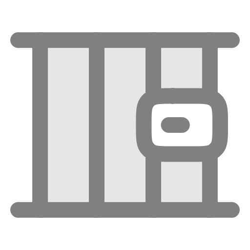
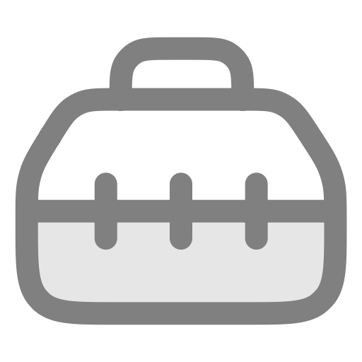

<table>
  <tr>
    <td>
      
    </td>
    <td>
      <h1>Anarchy</h1>
      
An alternative app source with a wide selection.

    </td>
  </tr>
</table>

<h2>Categories</h2>

  
  <strong>Trending Apps</strong> 
  Popular apps in the repository.

 

  
  <strong>Third-Party App Stores</strong> 
  Alternative platforms for discovering and installing apps.

 

  
  <strong>Jailbreak</strong> 
  Apps and tools for jailbroken devices.

 

  
  <strong>TrollStore</strong> 
  Apps compatible with TrollStore.

 

  
  <strong>Tweaked Apps</strong> 
  Modified apps with additional features.

 

  
  <strong>KFD</strong> 
  Apps and tweaks using the KFD exploit.

 

  
  <strong>MacDirtyCow</strong> 
  Apps and tweaks using the MacDirtyCow exploit.

 

  
  <strong>Emulators</strong> 
  Emulators for running software from other platforms.

 

  
  <strong>Games</strong> 
  Games for iPhone and iPad.

 

  
  <strong>AI Apps</strong> 
  Applications powered by artificial intelligence.

 

  
  <strong>Utilities</strong> 
  Tools that extend the functionality of your device.

 

  
  <strong>Browsers</strong> 
  Alternative web browsers for iOS.

 

  
  <strong>Safari Extensions</strong> 
  Extensions that add features to Safari.

 

  
  <strong>Photo &amp; Video</strong> 
  Photography, editing, and video applications.

 

  
  <strong>Music</strong> 
  Music players, streaming clients, and audio tools.

 

  
  <strong>Movies &amp; TV</strong> 
  Apps for streaming and watching movies and TV shows.

